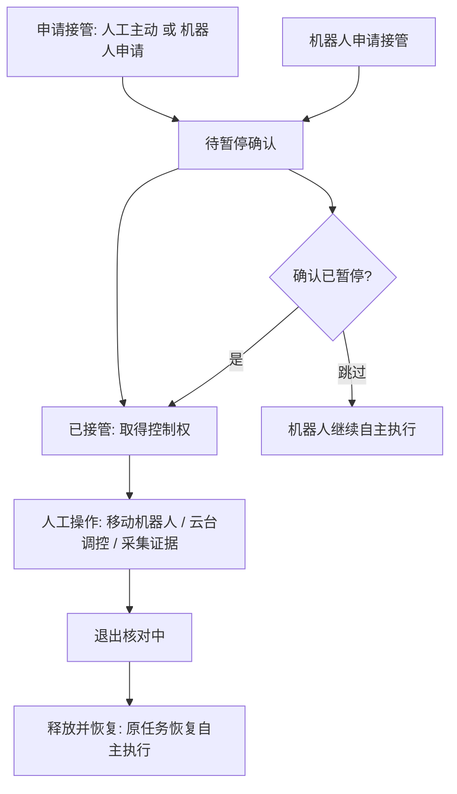

| 版本号 | 日期 | 修改人 | 修改描述 |
|--------|------|--------|----------|
| v1.0.0 | 2026-10-19 | AI Assistant | 基于平台代码与导航结构创建用户操作手册 |
| v1.1.0 | 2026-10-19 | AI Assistant | 大幅扩充各模块详细操作流程、端到端示例、状态流转图与常见问题 |

# 智能机器巡检平台 · 用户操作手册

> 本手册面向最终使用人员，按「看什么 → 点哪里 → 会发生什么」组织。页面具体字段与数值以演示界面为准（原型数据为浏览器本机 Mock，非真实设备）。
>
> 说明：部分页面已从左侧菜单收起，但仍保留功能，可由对应业务页的行内入口或链接进入（详见各章节）。

---

## 一、产品概述

### 1.1 平台定位
石化智能巡检一期业务原型，覆盖「设备台账 → 巡检点标注 → 计划编制 → 调度下发 → 机器人执行 → 结果采集 → 告警处理 → 分析报表」的完整业务闭环，用于业务演示与交互评审。

### 1.2 原型性质与演示数据
- **纯前端演示**：无后端、不连接真实机器人、不发真实指令；所有数据仅存在浏览器本机（localStorage）。
- **演示标识**：界面以「演示环境 / Mock」等标识提示数据为模拟。
- **可重置**：顶栏「↻ 重置演示」可恢复初始地图、任务与告警（见 2.3）。

### 1.3 九大业务中心一览

| 一级中心 | 主要页面 | 用途 |
|----------|----------|------|
| 工作台 | 我的工作台 | 待办 KPI 速览与入口 |
| 巡检执行 | 实时执行监控 / 人工操作与遥控 / 执行回溯 | 现场态势、接管遥控、过程回放 |
| 调度中心 | 巡检路线 / 巡检计划 / 任务列表 / 调度中心 / 队列 / 记录 | 路线、计划、派单、调度工作台 |
| 告警管理 | 告警记录 / 告警分类 / 告警设置 / 推送设置 | 告警事件、分类主数据、规则与推送 |
| 资源与地图 | 设备台账 / 设备巡检档案 / 巡检目标台账 / 巡检点管理 / 地图管理 | 设备、点位、地图等空间资源 |
| 机器人管理 | 机器台账 / 机器人运行监测 / 新增机器人 / 机器人能力 | 机器人资产与能力 |
| 分析与报表 | 分析报表 / 任务结果 / 巡检报表 | KPI、结果、报表 |
| 后台管理 | 工厂基础数据 / 算法模板 / 机器人能力 | 算法、能力、基础数据 |
| 系统设置 | 角色权限 / 组织用户 / 日志中心 / 参数配置 / 租户管理 / 能力服务 | 权限、配置、审计 |

---

## 二、登录与角色

### 2.1 登录
1. 打开平台进入登录页，输入账号后进入「我的工作台」。
2. 未登录时不加载后台外壳，仅显示登录页。

### 2.2 角色切换
- 顶栏用户菜单（右侧头像）中可**切换角色**（仅超级管理员可见，用于演示不同岗位视角）。
- 角色决定可见菜单、中心序号、页签与按钮级权限（见第六章）。

### 2.3 顶栏常用操作
| 控件 | 作用 |
|------|------|
| 侧边栏折叠（≡） | 收起/展开左侧导航，工作区自动占满，状态记忆到本机 |
| 返回（←） | 优先回「来时的页面」，其次按目录向上 |
| 页面评审 | 开启后可标注页面、汇总复制评审意见 |
| 驾驶舱大屏（🖥） | 新标签页打开独立大屏（数据大屏/机器人监控/视频监控流 三 Tab） |
| 重置演示（↻） | 清除本机操作记录，恢复初始演示数据 |
| 告警中心（🔔） | 打开告警弹窗 |
| 通知中心（✉） | 系统消息/任务通知/审批提醒 合并下拉 |
| 用户菜单 | 角色切换、查看数据范围、退出登录 |

> 离线（file://）打开时部分浏览器禁用本地存储，重置后仍可浏览但刷新会回到初始数据。

---

## 三、通用界面与操作

### 3.1 侧边栏导航
- 左上为「一级业务中心」，点击展开其下二级页面。
- 中心序号按当前角色可见范围连续编号；整组不可见的中心不占序号。
- 搜索时侧边栏按关键词（含业务词，如「异常」「接管」「验收」）过滤并高亮命中页面。

### 3.2 全局搜索
- 侧边栏顶部搜索框支持业务语言，命中页面在导航中高亮。

### 3.3 面包屑与返回
- 顶栏面包屑逐级可点；当前页高亮不可点。
- 内置详情页（任务详情、告警详情、结果详情等）通过链接带回的「来源页」动态归属，避免上下文串台。

### 3.4 多标签页签
- 仿浏览器多标签，记录访问过的页面，便于多功能页并存与快速切换。

### 3.5 右侧抽屉
- 新建/编辑计划、新建/编辑模板、配置编辑、巡检结果报告、对象与检测项、任务详情等以**右侧抽屉**呈现，不打断当前上下文。
- 较长表单的抽屉底部有**固定底栏**（按钮不随内容滚动、也不浮于内容之上）。

### 3.6 弹窗与二次确认
- 删除、取消计划、下发等关键操作会弹出**居中二次确认**弹窗，请阅读提示后确认。

### 3.7 列表通用操作
- **筛选**：点「筛选」展开面板，填写草稿条件后点「查询」才生效（不点时不影响列表）。
- **搜索**：行内搜索框通常即时或查询时生效。
- **分页**：底部页码 + 每页条数（默认 5 条，可切 10 / 20）。
- **多选删除**：列表常态不显示复选框；点「删除」进入选择态后出现复选框，勾选后二次确认。

### 3.8 驾驶舱大屏
- 顶栏「驾驶舱大屏」以新标签页打开，为独立窗口形态（不套后台外壳），含数据大屏、机器人监控、视频监控流三个 Tab，支持全屏。

### 3.9 告警中心与通知中心
- 「🔔」打开告警弹窗，可快速查看待处理告警。
- 「✉」打开通知中心，含系统消息、任务通知、审批提醒。

---

## 四、各业务模块详细操作

### 4.1 工作台（默认首页）
**进入**：登录后默认落地。
**布局**：顶部以待办 **KPI** 作为唯一入口，卡片按业务模块分类展示。
**操作**：
1. 查看各 KPI 卡片上的待办数量。
2. 点击某 KPI → 弹窗展开该类待办的**明细**（按业务维度分类）。
3. 点击明细行 → 直接进入对应处理页面（如任务列表、告警处理）。
**说明**：工作台**只读**，复核/处置等写操作一律到对应页面完成。

---

### 4.2 巡检执行（菜单隐藏，由入口进入）
**入口**：工作台「执行中任务」、调度台「监控」、机器人详情等。

#### 4.2.1 实时执行监控
- 查看单任务现场态势、控制带（视频 / 云台 / 声光语音）。
- 行内「监控」进入单任务现场态势内置页。

#### 4.2.2 人工操作与遥控（接管）
接管是一套由状态机驱动、可回退的流程：

**操作步骤**：
1. 进入「人工操作与遥控」页，页头选择目标机器人。
2. 若机器人自主处理超时，会出现「机器人申请人工接管」提示，可**接管（确认已暂停）**或**跳过（机器人继续）**。
3. 人工主动接管：点「申请接管（人工主动）」（离线机器人不可申请；受角色权限 `接管申请` 门控）。
4. 状态依次流转：**待暂停确认 → 已接管（借调中）→ 退出核对中 → 释放并恢复**。
5. 接管期间可在「现场态势」切换**实时视频 / 位置地图**，查看云台参数与操作回执；可移动、调控云台、采集证据。
6. 「本次接管采集证据」**独立留档，不覆盖**机器人自主结果；点「查看结果」可看证据详情。
7. 完成后在「退出核对中」阶段核对现场与任务，释放控制权，原任务恢复自主执行。

#### 4.2.3 执行回溯记录
- 由任务详情、设备档案、机器人、结果详情进入，回放任务过程（过程回放内置页）。

---

### 4.3 调度中心
**入口**：左侧菜单「调度中心 › 调度中心」；或巡检执行「监控」进入。

**布局**（调度中心工作台）：
- 顶部：平台态势总览。
- 左栏：**平台机器人资源列**（区域/电量/地图版本 · 当前任务与阶段进度 · 待执行与预计可用 · 阻塞提示）。
- 右栏工作区：**当前任务 / 待执行队列 / 待安排与异常任务 / 未来 4 小时排程**。

**派单与执行操作**：
1. 在左栏选择一台机器人（默认第一台，或带 `?id=` 进入时定位）。
2. 查看其「待安排」区（含待调度、已被接管待恢复、已分配被阻塞需改派的任务）。
3. 对可派单任务：
   - **下发执行 / 加入队列**：若无当前任务则直接下发，有当前任务则加入队列等待。
   - 按钮在**约束不满足时禁用**（如地图版本待同步、能力缺失），约束提示显示在「处理提示」列。
   - **紧急插单**：高优先级任务且当前任务执行中时出现。
   - **同步地图**：提示「地图版本待同步」时，点此跳到地图详情同步。
4. 「待执行队列」的任务显示「预计开始」时间（取自统一排程，与下方甘特同源）。
5. 点「详情」打开右侧**任务速览抽屉**（来源/类型/阶段/计划时间/排队位置/阻塞校验/点位快照），不离开调度上下文。
6. **临时任务**：点「临时任务」打开 `QuickTaskDrawer` 抽屉登记。

**历史记录**：已超期的原任务留档只读，不再提供派单入口，需要时新建补检。

---

### 4.4 巡检计划与任务
**入口**：调度中心 › 巡检路线 / 巡检计划 / 任务列表 / 目标与要求 / 任务日历。

#### 4.4.1 巡检路线
- 路线列表；「新建 / 编辑」进入路线编辑页（左表单 + 右地图画线）。
- 「导航」进入路线导航页（归属「巡检路线」目录）。

#### 4.4.2 巡检计划
- **新建/编辑计划**为右侧抽屉。
- **绑定机器人**：进入卡片式**能力对照**——绑定区先列模板需求（检测能力 / 服务区域 / 巡检点数），每台机器人标注「具备 / 缺失 / 另有」与可绑定结论；**不可绑定卡片置灰并列出缺失项**；选中卡片就地展开执行前提与能力可用性。
- 计划绑定机器人后**自动生成、下发并按时执行**；异常保留**阻塞原因**。
- 执行方式：周期任务（按周期循环）/ 定时任务（指定日期执行一次）。

#### 4.4.3 任务列表
- 支持按**来源 / 状态 / 机器人 / 时间范围**筛选（时间范围默认「今日」，最大跨度锁 30 天）。
- **一键派单**：未分配任务选机器人派单。
- **多选删除**：点「删除」进入选择态，勾选后二次确认（TASK-05）。
- 「详情」打开右侧抽屉（概要头 + 任务摘要 / 控制与版本约束 / 派单历史 / 检测项快照与结果），面板内主操作跳转后抽屉自动关闭，列表筛选与分页不丢。

#### 4.4.4 目标与要求 / 任务日历
- 目标与要求：临时任务统一为抽屉。
- 任务日历：按日历视图查看任务排程。

---

### 4.5 告警管理

#### 4.5.1 告警记录
- 事件列表；点记录进入**告警详情 / 处理**（含处理动作）。

#### 4.5.2 告警分类
- 分类名称 + 告警大类 + 是否启用；是记录筛选与告警设置「告警类型」的数据源。

#### 4.5.3 告警设置
- 一个台账一个告警设置（可含多个告警项），与**巡检目标台账同一份数据**。

#### 4.5.4 推送设置
- 按**等级 + 区域 / 设备范围**维护推送人员名单。

---

### 4.6 资源与地图

#### 4.6.1 设备台账
**布局**：左侧设备树 + 右侧设备台账。
**操作**：
1. **建档**：点「＋ 新增设备」打开表单（设备编码/名称/形态/区域/安装位置）。安装位置可在**厂区 2D 底图**上打点（自动代入坐标）。
2. **Excel 导入**：进入设备台账，点「导入」→ 在弹窗里先「下载 Excel 模板」拿到带说明的表格，按提示填写后上传（仅接受 `.xlsx / .xls`，先解析预览再落库）。
   - 模板含两个工作表：**「设备导入模板」**（按列填写数据）+ **「填写说明」**（每列怎么填、哪些系统生成）。
   - 填写要点（一行为一台设备）：

   | 列 | 必填 | 填写说明 | 示例 |
   |----|------|----------|------|
   | 设备编码 | 必填 | 业务唯一键；与已有编码重复时按编码更新该设备 | V010 |
   | 设备名称 | 必填 | 设备显示名称 | V010 新增储罐 |
   | 设备形态 | 选填 | 留空时按名称/类型自动判定（罐区/管廊/围堰等→虚拟设备，其余→实体设备） | 实体设备 / 虚拟设备 |
   | 所属区域 | 选填 | 设备归属区域；留空按安装位置前缀推导 | 一期罐区 |
   | 安装位置 | 选填 | 安装位置描述；也可在台账内底图打点生成坐标 | 一期罐区东侧 |
   | 巡检项 | 必填 | 一台设备的多个检测目标，用「、」分隔；采集方式与单位系统按默认填 | 液位计、罐壁温度 |

   - **系统自动生成、无需填写**：检测项 ID、类型（仪表/区域）、分类（压力/温度/阀位/液位/流量/气体浓度）、更新时间——均由平台按检测目标名称自动判定，不在模板列中。
3. **删除**：多选批量删除（二次确认）。
4. 行内「设备巡检档案」「巡检目标」进入对应内置页。

#### 4.6.2 设备巡检档案（菜单隐藏）
- 由设备台账行内进入，内含**结果详情 / 告警详情 / 执行回溯**内置页。

#### 4.6.3 巡检目标台账
- 维护仪表/阀门等检测对象的「检什么、怎么判」（算法模板与判定口径）。
- 行内「＋添加 / 编辑」打开整页编辑（内置页）。

#### 4.6.4 巡检点管理
**入口**：资源与地图 › 点位与对象 › 巡检点管理。
**概念**：
- **巡检点 = 巡检点名称 + 地图 + 标定点（定位 ID）+ 多个巡检项**。
- **巡检项 = 巡检项名称 + 巡检目标台账 + 机器操作内容（原子动作 / 云台参数）**。
- 状态仅两态：**已启用 / 停用**。
- 区域按覆盖设备的归属判定（无设备时回退该点所在地图区域）。

**操作**：
1. 列表支持筛选：巡检点名称 / 巡检项名称 / 关联设备 / 状态；搜索、分页。
2. **巡检点导入**：点导入打开抽屉——先选**数据来源机器人**，再拉取/上传表格文件（与地图管理并列；地图归地图管理，标定文件归本页，两者按定位 ID 绑定）。
3. 行内「编辑巡检点」进入编辑内置页（point-edit，新增/编辑合并为一页：基本信息 + 巡检项清单/详情就地切换）。
4. 从地图详情带 `mapId` 进入仅用于预选导入归属地图，不影响列表结果。

#### 4.6.5 采集结果与告警规则（菜单隐藏）
- 规则配置挂在点位上，由巡检点列表进入。

#### 4.6.6 地图管理
- 地图列表、详情（含地图下发抽屉）、标定工作台（像素地图打点、连线成路网）、地图导航实时监控（选完机器人进入）。

---

### 4.7 机器人管理
**入口**：左侧菜单「机器人管理 › 机器台账」（运行监测/新增/能力 为台账内置入口）。

- **机器台账**：机器人清单；行内「机器人名」进入运行监测，「＋ 新增机器人」进入新增表单，「能力摘要」进入能力页。
- **机器人运行监测 / 新增机器人 / 机器人能力**：均降为台账内置页（菜单隐藏），由台账进入。
- **机器人能力**：展示视觉/红外/气体/声音/导航/电池/通信等能力可用性（正常 / 未接入 / 低电量）。

---

### 4.8 分析与报表
- **分析报表（KPI）**：指标看板（与驾驶舱、报表同口径，统一取自指标中心）。
- **任务结果**：按任务/巡检点查询结果。
- **巡检报表**：巡检结果报表。

---

### 4.9 后台管理
- **工厂基础数据**：区域 / 设备 / 仪表等基础配置。
- **算法模板**：平台维护「看什么 / 怎么采 / 拿什么算 / 怎么判」的唯一入口；台账选一条模板即带出算法与判定口径。
- **机器人能力**：两级清单（能力类型 → 能力参数），巡检项能力项的候选来源。

---

### 4.10 系统设置
- **角色 / 权限**：权限口径集中在 `roles.ts`，按钮级门控由 `Can` 组件控制。
- **组织 / 用户**（菜单隐藏）、**日志中心**、**参数配置中心**、**租户管理**、**能力 / 服务管理**（菜单隐藏）。

---

## 五、端到端操作流程（示例）

### 5.1 新建设备并配置检测项
1. 资源与地图 › 设备台账 → 点「＋ 新增设备」或在导入抽屉上传 Excel。
2. 填写编码/名称/形态/区域，安装位置可在底图打点。
3. 行内「巡检目标」进入检测项维护页，定义各检测对象的判定口径（或引用算法模板）。

### 5.2 标注巡检点并验证
1. 设备台账/巡检点管理 → 巡检点导入（选数据来源机器人，上传标定文件，按定位 ID 与地图绑定）。
2. 行内「编辑巡检点」补充巡检项（名称 + 巡检目标台账 + 原子动作/云台参数）。
3. 状态置「已启用」。

### 5.3 编制巡检计划并绑定机器人
1. 调度中心 › 巡检计划 → 新建计划（右侧抽屉）。
2. 在卡片式能力对照中选择可绑定机器人（不可绑定卡片置灰并列出缺失项）。
3. 保存后计划自动生成任务并下发、按时执行；若约束不满足则保留阻塞原因。

### 5.4 调度下发与执行监控
1. 调度中心 › 调度中心 → 选机器人。
2. 在「待安排」区对任务「下发执行 / 加入队列」；有约束时先解约束（如同步地图）。
3. 实时执行监控查看现场态势；必要时进入人工接管。

### 5.5 人工接管处理异常
1. 执行监控/人工操作与遥控 → 选择机器人 → 申请接管。
2. 按状态流转完成移动/云台/采集，释放后原任务恢复。

### 5.6 查看结果与处理告警
1. 分析与报表 › 任务结果 查看采集结果与判定。
2. 告警管理 › 告警记录 处理触发告警；告警设置维护规则与推送名单。

### 5.7 分析报表与导出
1. 分析报表查看 KPI；巡检报表导出/查看报表。

---

## 六、角色与权限

- 权限口径集中在 `roles.ts`；侧边栏过滤、中心序号、页签清理、按钮级门控共用同一套。
- **超级管理员**：可见全部页面（含租户管理）。
- **租户管理员**：在管理员档位上去掉「租户管理」。
- **按钮级门控**：如「申请接管」需 `接管申请` 权限；无权限按钮自动隐藏或禁用。
- 无权限页面：内容区提示「当前角色无该页面访问权限」，引导切换角色或返回默认工作台。

---

## 七、状态与演示数据说明

- **状态机**：所有状态变更走状态机（`act` → `transition`），未知动作会抛错并由全局 toast 提示。
- **指标口径唯一**：KPI / 驾驶舱 / 报表统一取自指标中心，页面内不得自行计算。
- **演示数据集中**：业务 Mock 数据集中在种子数据；服务不可用时直接报错提示，不写「降级返回模拟响应」。
- **自动化限制**：自动化仅在**浏览器页面打开时**运行（非服务器定时服务）；老缓存中未绑定机器人的计划需编辑保存后生效。
- **未接入项**：真实音视频与机器人接口尚未接入，相关画面为示意。

---

## 八、常见问题（FAQ）

**Q1：为什么有些页面在左侧菜单找不到？**
A：这些页面已从菜单收起（如实时执行监控、机器人运行监测、设备巡检档案、执行回溯、告警设置等），但仍保留功能，可由对应业务页的行内入口或链接进入。

**Q2：重置演示会丢失什么？**
A：清除本机操作记录，恢复初始地图、任务与告警。离线打开时刷新也会回到初始数据。

**Q3：计划没有自动执行？**
A：检查计划是否已绑定机器人；老缓存中未绑定的计划需编辑保存后生效。自动化仅在页面打开时运行。

**Q4：接管后原任务去哪了？**
A：接管为「借调」：任务暂停 → 人工操作 → 释放 → 恢复原任务自主执行。可在「退出核对中」核对后释放。

**Q5：巡检点导入提示地图/标定不匹配？**
A：地图与标定文件按**定位 ID** 绑定；请确认两者来自同一趟现场采集。

**Q6：列表被莫名筛空？**
A：筛选态记忆在会话存储，可能残留已不存在的选项（如旧状态值），系统会自动回退「全部」；若仍异常，重置演示即可。

---

## 九、附录

### 9.1 术语表
| 术语 | 含义 |
|------|------|
| 巡检点 | 名称 + 地图 + 标定点 + 多个巡检项 |
| 巡检项 | 名称 + 巡检目标台账 + 机器操作内容 |
| 接管（借调） | 临时取得机器人控制权，完成后恢复原任务 |
| 待安排 | 待调度 / 已被接管待恢复 / 已分配被阻塞需改派 |
| 阻塞原因 | 计划/任务因约束未满足而暂不执行的原因 |

### 9.2 离线使用
- `静态版/index.html` 为自包含单文件，双击即可浏览（避开浏览器对 file:// 外链 ES module 的 CORS 拦截）；部分浏览器禁用本地存储时刷新回到初始数据。

### 9.3 多租户
- 顶栏租户切换器可切到不同租户数据上下文；停用租户在切换器中不可选。

### 9.4 评审留痕
- 顶栏「页面评审」开启后可标注页面并汇总复制评审意见，便于交互评审。
