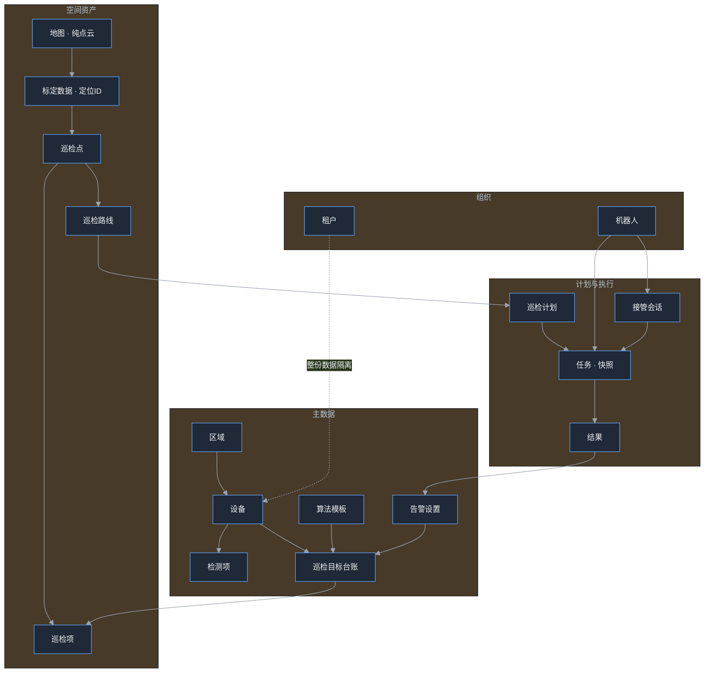
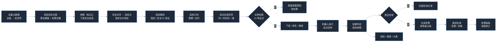

# 石化智能巡检业务平台（一期）产品需求与业务逻辑说明

> 本文档面向**产品评审、业务确认、测试验收与实施交付**，只回答三件事：**功能有哪些、流程怎么走、规则是什么**。
> 不涉及技术实现（技术栈、路由、数据结构、代码位置由研发自行决定）。
> 与其它文档分工：`00-用户操作手册.md` 讲「用户怎么点」，本文讲「业务怎么跑、字段怎么填、异常怎么处理」。

---

## 版本历史

| 版本号    | 日期         | 修改人  | 修改描述                                         |
| ------ | ---------- | ---- | -------------------------------------------- |
| v1.0.0 | 2026-10-19 | kyan | 初始文档，功能架构 → 业务流程 → 业务字段 → 业务规则 → 状态字典 → 一期边界 |

---

## 1. 产品概述

### 1.1 产品定位

面向石化厂区的**机器人巡检业务管理平台**，把「设备要巡什么、机器人怎么巡、巡完结果算不算异常、异常谁来处理」四件事串成一条线上闭环，替代纸质巡检与人工盯屏。

主要使用端：

| 端 | 使用者 | 用途 |
|----|--------|------|
| Web 管理端 | 设备工程师、调度员、值班主管、系统管理员 | 建档、排班调度、结果与告警处理、配置管理 |
| 驾驶舱大屏 | 厂级管理者、调度指挥岗 | 全局态势与调度指挥 |

### 1.2 解决的核心问题

| 痛点 | 平台对应能力 |
|------|--------------|
| 巡检靠人工排、靠经验派活 | 计划自动生成任务 + 派单前 10 项可用性校验，不可用给出明确阻塞原因 |
| 巡了什么、有没有漏，说不清 | 路线/计划驱动的任务，逐点执行留痕，结果可回溯 |
| 异常判定口径不统一、事后无法解释 | 结果判定全局统一口径，判定时冻结规则快照 |
| 告警发出去没人管、误报率说不清 | 告警受理/忽略留痕 + 是否误报统计 + 按等级/区域/设备推送 |
| 机器人被临时借用后任务乱套 | 人工接管会话机制：暂停 → 接管 → 退出核对 → 释放并恢复 |

### 1.3 一期范围

**包含**：设备主数据、检测项、巡检目标台账（算法模板 + 告警设置）、地图与标定、巡检点、巡检路线、巡检计划、任务调度与派单、执行监控与人工接管、结果判定、告警处置与推送、指标报表、机器人与能力管理、组织租户与权限、驾驶舱大屏。

**不包含**（不在一期验收范围）：

- 机器人本体导航/SLAM 算法、硬件固件与底层控制；
- 跨地图自动切换执行（一次任务只在一张地图内完成）；
- 巡检结果的人工复核环节（一期为异常即告警）；
- 告警自动复检闭环（如 30 天未处理派生复检单，一期不提供）；
- 服务端定时调度能力（一期的自动生成任务依附于页面运行，见第 9 章）。

### 1.4 使用角色

| 角色      | 主要职责            | 高频功能                |
| ------- | --------------- | ------------------- |
| 系统管理员   | 组织、区域、账号、参数维护   | 工厂基础数据、角色权限、日志      |
| 设备工程师   | 设备与检测项建档、巡检目标配置 | 设备台账、巡检目标台账、任务结果查看  |
| 机器人运维   | 地图、标定、机器人资产与能力  | 地图管理、巡检点管理、机器台账     |
| 调度员     | 路线、计划、派单与插单     | 巡检路线、巡检计划、调度中心（派单台） |
| 值班主管    | 告警受理与处置跟踪       | 告警记录、告警详情、推送设置      |
| 数据分析/安全 | 指标与报表           | 分析报表、巡检报表、驾驶舱       |

---

## 2. 功能架构

### 2.1 九大业务中心

| 序号  | 中心    | 定位                  | 包含页面                                      |
| --- | ----- | ------------------- | ----------------------------------------- |
| 01  | 工作台   | 登录默认落地页，角色待办与快捷入口   | 工作台速览                                     |
| 02  | 调度中心  | 路线 → 计划 → 任务 → 派单主线 | 巡检路线、路线编辑、路线导航、巡检计划、计划编辑、任务列表、调度中心、实时执行监控 |
| 03  | 告警管理  | 告警产生后的处置闭环          | 告警记录、告警详情、告警设置、告警分类、推送设置                  |
| 04  | 资源与地图 | 主数据与空间资产            | 设备台账、巡检目标、巡检目标台账、巡检点管理、巡检点编辑、地图管理、地图详情    |
| 05  | 机器人管理 | 机器人资产与能力            | 机器台账、机器人详情、新增机器人、机器人能力                    |
| 06  | 分析与报表 | 指标与结果输出             | 分析报表（指标中心）、任务结果、巡检报表                      |
| 07  | 后台管理  | 平台级主数据              | 工厂基础数据、算法模板、机器人能力清单                       |
| 08  | 系统设置  | 组织、权限、租户            | 角色/权限、日志中心、参数配置、租户管理（超级管理员）、              |

### 2.2 页面呈现形态（业务约定）

| 形态     | 用在哪                            | 业务含义                   |
| ------ | ------------------------------ | ---------------------- |
| 列表页    | 可分页、可筛选的业务集合（设备、告警、任务、路线、计划）   | 默认每页 5 条，支持条件筛选与分页     |
| 详情/编辑页 | 内容较多的表单型对象（计划、路线、台账、巡检点、机器人）   | 独立页面进入，可返回列表，保留面包屑     |
| 右侧抽屉   | 不打断上下文的速览或轻量编辑（任务速览、告警规则、临时任务） | 不跳页，看完即关               |
| 居中弹窗   | 二次确认、接管确认、轻提示                  | 破坏性操作必须二次确认            |
| 大屏     | 驾驶舱总览 / 调度指挥                   | 独立新窗口打开，自动滚动，支持全屏与厂区切换 |

### 2.3 菜单可见性约定

| 类型             | 说明              | 典型页面                                                 |
| -------------- | --------------- | ---------------------------------------------------- |
| 一级菜单可见         | 侧边栏常驻           | 工作台、设备台账、巡检目标台账、告警记录、调度中心、任务列表                       |
| 菜单收起（由页面内入口进入） | 属于流程中的环节，不做常驻入口 | 实时执行监控、人工遥控、执行回溯、临时任务、任务队列、任务日历、机器人详情、健康度、告警规则、用户、服务 |
| 仅由行内链接进入       | 依赖具体业务对象，无独立入口  | 巡检点编辑、任务详情、结果详情、告警详情、回溯详情、执行监控、目标编辑、路线编辑、设备巡检目标、地图详情 |

> 菜单收起不代表功能裁剪，权限判断与页面内操作保持一致。

---

## 3. 核心业务对象与字段

### 3.1 业务对象关系

一句话理解数据链路：**设备定「巡什么」→ 台账定「怎么判」→ 地图/标定定「在哪」→ 巡检点定「采哪些数据」→ 路线定「按什么顺序」→ 计划定「什么时候」→ 任务定「这一趟的具体快照」→ 结果定「是否异常」→ 告警定「谁来处理」。**

### 3.2 关键业务字段

> 全部字段表统一四列：**字段 / 业务含义 / 是否必填 / 填写规则**。
> 「是否必填」取值：`是`、`否`、`条件必填`、`系统生成`（系统生成的字段用户不填，规则列只说明取值与影响）。

#### 3.2.1 设备

| 字段     | 业务含义                | 是否必填 | 填写规则                                  |
| ------ | ------------------- | ---- | ------------------------------------- |
| 设备编码   | 设备唯一标识，**业务主键**     | 是    | 全局唯一； 导入时编码重复视为同一台设备并更新            |
| 设备名称   | 现场叫法                | 是    | 各页面展示用，建议与现场标识牌一致                     |
| 设备形态   | 实体设备 / 虚拟设备         | 是    | 默认选中实体设备； 不支持用户手填                  |
| 所属区域   | 区域树节点（厂区 / 装置 / 单元） | 是    | 决定任务区域匹配、数据从【工厂基础数据】按区域获取； 不支持用户手填 |
| 安装坐标   | 现场位置文字说明            | 否    | 在底图上打点后自动带入，可手工补充                     |
| 最近更新时间 | 最后修改时间              | 系统生成 | 台账列表展示，最大精度到分钟 用户填写完成，系统自动获取时间进行展示 |

#### 3.2.2 检测项（设备下的检测目标）

| 字段    | 业务含义                               | 是否必填 | 填写规则                         |
| ----- | ---------------------------------- | ---- | ---------------------------- |
| 检测项编号 | 检测项标识                              | 系统生成 | 不要求填写； Excel 导入时也不出现在模板列中 |
| 检测项名称 | 具体测点，如「1#罐顶压力」                     | 是    | 可手工覆盖                        |
| 类型    | 实体 / 虚拟（数据口径为仪表 / 区域）              | 是    | 只能选择； 不支持用户手填             |
| 分类    | 压力 / 温度 / 阀位 / 液位 / 流量 / 气体浓度 / 环境 | 是    | 只能选择； 不支持用户手填             |

#### 3.2.3 巡检目标台账（判定口径的唯一来源）

| 字段          | 业务含义                         | 是否必填 | 填写规则                              |
| ----------- | ---------------------------- | ---- | --------------------------------- |
| 巡检目标        | 一个仪表 / 区域 / 环境目标； （观察的对象） | 是    | 数据从【设备台账-检测项】拉取过来；             |
| 算法模板        | 绑定的识别算法                      | 是    | 决定可采集方式、检测类型与判定方式                 |
| 告警设置（多条告警项） | 阈值型或状态型判定条件                  | 是    | 至少 1 条；**第一条为主告警项**，台账列表与判定展示以它为准 |
| 风险等级        | 一级 / 二级 / 三级                 | 是    | 决定告警等级，一级最严重                      |
| 启用状态        | 开 / 关                        | 是    | 关闭后不参与新任务的判定与告警生成                 |

#### 3.2.4 地图

| 字段 | 业务含义 | 是否必填 | 填写规则 |
|------|----------|----------|----------|
| 地图名称 | 地图显示名称，如「一期罐区点云」 | 是 | 新建地图不允许重名；更新地图时允许重名 |
| 地图编号 | 地图唯一编号，如 MAP-A01 | 系统生成 | 不要求填写 |
| 所属区域 | 地图归属区域，参与派单区域匹配 | 是 | 从【后台管理 - 工厂基础数据】区域树拉取 |
| 点云文件 | 底图与建图信息 | 是 | **只含纯点云底图，不含定位 ID、不含巡检点** |
| 空间版本 V{n} | 地图修订版本 | 系统生成 | 每次地图修订 +1；下发时自动定版；标定改动不升版本 |
| 启用状态 | 启用 / 停用 | 是 | 新建默认启用，用户可点击修改；**停用前需判定是否存在绑定当前版本地图、处于已分配状态的机器人任务**，存在则不允许停用 |
| 同步状态 | 机器人侧地图是否都已同步到当前版本（列表徽标） | 系统生成 | 已同步：所有绑定该地图的机器人（含从未绑定过的）均已更新到当前版本；未同步：① 存在绑定老版本但未同步的机器人；② 第一版地图且从未绑定过机器人 |
| 版本同步 | 逐台机器人「正在运行的版本」与「地图当前版本」的对照（详情页） | 系统生成 | 全部一致 → 显示「全部已同步（当前 V{n}）」；有落后 → 逐台列出「Rxx 运行 Vx（当前 Vy）」并提供「去更新」入口；0 台 → 显示「尚未下发给任何设备」并提供「下发」入口 |
| 已激活设备 | 已绑定本图数据的机器人（绑定即视为在用） | 系统生成 | 显示台数与机器人编号；0 台显示「暂无设备激活本图」，表示地图尚未部署到机器人 |
| 更新时间 | 最后修改时间 | 系统生成 | 列表与详情展示 |

#### 3.2.5 标定数据

| 字段 | 业务含义 | 是否必填 | 填写规则 |
|------|----------|----------|----------|
| 定位 ID | 标定点与巡检点的绑定键，用于用户标识 | 系统生成 | 与地图分开存放、分别上传；不是业务主键；**【采集巡检点坐标】时自动生成，并自动与巡检点绑定** |
| 坐标 | 标定点在地图上的位置，直接关联唯一的巡检点 | 系统生成 | 由标定文件带入；地图重传后按坐标匹配，坐标与地图无关联；**【采集巡检点坐标】时自动生成，并自动与巡检点绑定** |

#### 3.2.6 巡检点

| 字段 | 业务含义 | 是否必填 | 填写规则 |
|------|----------|----------|----------|
| 名称 | 现场可识别的点位名 | 是 | 建议与现场标识一致；同一地图内不重名 |
| 所属区域地图 | 标定巡检点需要使用地图做标记，后续直接使用坐标标识 | 是 | 从已启用的地图中选择；一个巡检点只属于一张地图 |
| 巡检点坐标 | 点位在地图上的位置坐标 | 是 | 点击「现场标定」进行记录，自动生成定位点 ID；地图重传后按坐标匹配，坐标与地图无关联；【采集巡检点坐标】时系统自动生成并自动与巡检点绑定 |
| 巡检项 | 该点要采集的检测目标集合 | 是 | 至少 1 个，最多 20 个 |
| 状态 | 已启用 / 停用 | 是 | 停用后派单校验不通过 |

#### 3.2.7 巡检项

| 字段 | 业务含义 | 是否必填 | 填写规则 |
|------|----------|----------|----------|
| 名称 | 本次采集动作的名称，如「罐顶红外测温」 | 是 | 同一巡检点下不重复 |
| 巡检目标台账 | 引用的巡检目标台账，决定判定口径与告警规则 | 是 | 从【巡检目标台账】拉取；只能选择，不支持用户手填 |
| 能力项 | 当前巡检项需要机器人做什么「工作」 | 是 | 能力类型 + 能力参数从【后台管理 - 机器人能力】拉取；用户需按能力手动配置 |
| 原子动作 + 云台参数 | 最小设备动作，操控机器人（上装 + 位姿） | 是 | 记录坐标、位姿、云台参数；一个巡检项记录一条原子动作内容 |

#### 3.2.8 巡检路线

| 字段 | 业务含义 | 是否必填 | 填写规则 |
|------|----------|----------|----------|
| 路线名称 | 用户对路线的标识 | 是 | 不重名 |
| 所属地图 | 路线作用范围。地图只帮机器人知道路线上的巡检点在哪、怎么去做 | 是 | 一条路线落一张地图；**地图更新不强制更新路线** |
| 路线方式 | 固定路线 / 自定义路线 | 是 | 固定路线沿已标定路网自动寻路，视为已验证，默认启用；自定义路线必须导航实跑验证，默认停用，验证通过后启用 |
| 巡检点序列 | 执行顺序 | 是 | 顺序即执行顺序；自定义路线以画线顺序为准 |
| 路径锚点 / 曲线标记 | 自定义路线的走线形状 | 否 | 锚点只引用已有巡检点，不新建 / 删除点位；固定路线不需要 |
| 状态 | 启用 / 停用 | 是 | 自定义路线保存后强制「停用 + 未验证」 |
| 验证机器人 / 验证时间 | 验证留痕 | 系统生成 | 导航实跑验证通过时写入，写入后才允许启用 |

#### 3.2.9 巡检计划

| 字段 | 业务含义 | 是否必填 | 填写规则 |
|------|----------|----------|----------|
| 计划名称 | 计划标识 | 是 | 建议体现区域 + 频次 |
| 计划类型 | 周期任务 / 定时任务 | 是 | 周期需起止日期与班次 / 日 / 周 / 月循环；定时为一次性指定时刻 |
| 绑定路线 | 执行路线 | 是 | 一次计划对应一条路线 |
| 绑定机器人 | 指定执行机器人 | 否 | 留空由派单时选择；绑定后校验能力匹配 |
| 提前生成量 | 提前多少分钟生成任务 | 是 | 默认按业务习惯设定 |
| 超时 / 等待时长 | 单任务超时、点位间等待 | 是 | 超时后任务判定为「超期」 |
| 状态 | 启用 / 停用 | 是 | 停用后不再生成任务 |
| 生成异常 / 最近生成时间 | 生成结果留痕 | 系统生成 | **不可用时不静默跳过，必须留下失败原因** |

#### 3.2.10 任务

| 字段 | 业务含义 | 是否必填 | 填写规则 |
|------|----------|----------|----------|
| 任务来源 | 计划生成 / 临时任务 / 插单 | 系统生成 | 决定是否关联计划 |
| 任务类型 | 常规巡检 / 特巡等 | 是 | 影响执行要求与展示 |
| 计划标识 / 时间点标识 | 计划与生成时点 | 系统生成 | 用于保证**同一计划同一时刻只生成一条任务** |
| 执行机器人 | 派单结果 | 系统生成 | 派单时锁定 |
| 地图与地图版本 | 派单时锁定的空间基线 | 系统生成 | 机器人地图版本不一致则不能派单 |
| 巡检点与巡检项快照 | 任务创建时的点位与检测配置 | 系统生成 | 快照制：后续改配置不影响已生成任务 |
| 原子动作 | 本次任务要做的动作集合 | 系统生成 | 由巡检项配置决定 |
| 状态 / 阶段 / 当前点位序号 | 执行进度 | 系统生成 | 见第 7 章状态字典 |
| 已完成 / 已跳过点位 | 执行明细 | 系统生成 | 支持部分完成 |
| 失败原因 / 重试次数 | 异常留痕 | 系统生成 | 失败可回到待调度重新派单 |
| 计划开始 / 实际开始 / 实际结束 / 截止时间 | 时间留痕 | 系统生成 | 超期以截止时间判定 |

#### 3.2.11 结果

| 字段 | 业务含义 | 是否必填 | 填写规则 |
|------|----------|----------|----------|
| 所属任务 / 巡检点 / 巡检项 | 定位结果来源 | 系统生成 | 由执行过程自动关联 |
| 原始值 / 识别值 / 最终值 / 单位 | 三级读数 | 系统生成 | 最终值参与判定 |
| 风险异常 / AI 状态异常 | 两类异常标记 | 系统生成 | 风险异常按规则等级告警；AI 状态异常固定三级告警 |
| 判定状态 | 正常 / 异常 / 无效 | 系统生成 | 全局统一口径，见 6.9 |
| 置信度 | 识别可信度 | 系统生成 | 用于展示与问题排查 |
| 触发原因 / 阈值文案 / 读数文案 | 给业务看的人话解释 | 系统生成 | 统一话术生成，不由各页面自行拼装 |
| 规则快照 | 判定当时的阈值与期望状态 | 系统生成 | **历史结果按快照展示，规则后续变更不回溯** |
| 采集时间 | 结果产生时间 | 系统生成 | 按现场回传时间记录 |

#### 3.2.12 告警

| 字段 | 业务含义 | 是否必填 | 填写规则 |
|------|----------|----------|----------|
| 告警大类 | 业务告警 / 机器人告警 | 系统生成 | 业务告警类别由台账告警设置派生；机器人告警显式指定 |
| 告警等级 | 一级 / 二级 / 三级 | 系统生成 | 一级最严重，由风险等级或异常类型决定 |
| 关联对象 | 结果 / 任务 / 巡检点 / 机器人 | 系统生成 | 便于从告警反查证据 |
| 状态 | 待确认 / 处理中 / 待复查 / 已恢复 / 已关闭 | 系统生成 | 见第 7 章 |
| 处理结果 | 受理 / 忽略 | 条件必填 | 处理告警时二选一，写入后不可二次编辑 |
| 处理说明 / 处理留痕 | 文字记录 | 条件必填 | 选「受理」时必须填写说明；记录为追加式，不清空历史 |
| 是否误报 | 是 / 否 | 条件必填 | 处理时填写，用于误报率与准确率统计 |
| 处理时间 | 处理动作发生时间 | 系统生成 | 处理提交时写入 |

#### 3.2.13 接管会话

| 字段 | 业务含义 | 是否必填 | 填写规则 |
|------|----------|----------|----------|
| 机器人 / 关联任务 | 被接管的执行对象 | 是 | 同一机器人同时只允许 1 个会话 |
| 来源 | 人工主动 / 机器人申请 | 是 | 机器人申请需人工确认后才进入接管 |
| 状态 | 待暂停确认 / 已接管 / 退出核对中 / 已释放 / 已超时 | 系统生成 | 见第 7 章 |
| 有效期 | 会话超时时间 | 系统生成 | 超时自动释放，任务停在「已被接管」等待人工恢复 |
| 指令序号 | 防指令乱序 | 系统生成 | 业务只需知道「过期指令不生效」 |
| 云台角度 / 起止时间 | 接管过程留痕 | 系统生成 | 用于复盘 |

#### 3.2.14 机器人

| 字段 | 业务含义 | 是否必填 | 填写规则 |
|------|----------|----------|----------|
| 机器人编码 | 机器人唯一标识 | 是 | 全局唯一 |
| 机型 | 机器狗 / 四轮车 / 挂轨 | 是 | 影响可用性判断与轨道占用约束 |
| 所属区域 / 绑定地图与版本 | 执行范围与空间基线 | 是 | 参与派单区域与地图版本校验 |
| 约束条件 | 最低电量、挂轨区段、最高速度 | 是 | 低于最低电量不可派单；挂轨机型的区段不可被两台机器人同时占用 |
| 能力清单 | 采集能力 + 原子动作能力 | 是 | 决定能接哪些任务，参与派单校验 |
| 电量 / 健康度 | 实时状态 | 系统生成 | 由机器人回传 |
| 状态 | 空闲 / 执行中 / 暂停 / 人工接管 / 充电 / 故障 / 离线 / 维护 / 返航中 | 系统生成 | 见第 7 章 |
| 固件版本 | 本体固件 | 否 | 用于版本对齐与问题定位 |

#### 3.2.15 租户

| 字段 | 业务含义 | 是否必填 | 填写规则 |
|------|----------|----------|----------|
| 名称 | 租户名称 | 是 | 如华东炼化、西部管道 |
| 编码前缀 | 数据标识前缀 | 是 | 如 HD·/XB·，用于区分租户数据 |
| 状态 | 启用 / 停用 | 是 | 当前租户不可停用；至少保留一个启用租户 |
| 更新时间 | 最后修改时间 | 系统生成 | 列表展示 |

---

## 4. 端到端业务流程

### 4.1 主流程：从建档到告警闭环

| 步骤 | 角色 | 功能位置 | 动作 / 系统行为 |
|------|------|----------|------------------|
| 1 | 系统管理员 | 后台管理 › 工厂基础数据 | 维护区域树（区域是设备、机器人、任务的共同归属） |
| 2 | 设备工程师 | 资源与地图 › 设备台账 | 新增设备或 Excel 批量导入（按编码聚合，同设备多行合并为多检测项） |
| 3 | 设备工程师 | 设备台账 › 巡检目标 | 维护检测项（名称 / 类型 / 分类），类型与分类可自动推导 |
| 4 | 设备工程师 | 资源与地图 › 巡检目标台账 | 为检测目标绑定算法模板 + 告警设置（可多条告警项，首条为主告警项） |
| 5 | 机器人运维 | 资源与地图 › 地图管理 | 导入点云地图 → 下发 → 系统自动定版 |
| 6 | 机器人运维 | 资源与地图 › 巡检点管理 | 导入标定文件（按定位 ID 绑定）或新增巡检点（名称 + 所属区域地图 + 巡检点坐标 + 多个巡检项） |
| 7 | 调度员 | 调度中心 › 巡检路线 | 建固定路线或自定义路线；自定义路线需导航实跑验证后才能启用 |
| 8 | 调度员 | 调度中心 › 巡检计划 | 建周期/定时计划，绑定机器人与路线，设提前量、超时、等待 |
| 9 | 系统 | 调度中心 | 按提前量自动生成任务（同一计划同一时刻只生成一条），同时校验机器人可用性，不可用则记录阻塞原因 |
| 10 | 调度员 | 调度中心 › 派单台 | 确认派单 / 加入队列 / 紧急插单 / 同步地图；派单前执行 10 项校验 |
| 11 | 机器人 | 巡检执行 › 实时执行监控 / 现场态势 | 接收 → 启动 → 逐点执行 → 回传阶段与结果 |
| 12 | 设备工程师 | 分析与报表 › 任务结果 | 查看结果、判定依据（规则快照）与现场证据 |
| 13 | 值班主管 | 告警管理 › 告警记录 | 受理 / 忽略，填写处理说明与是否误报 |
| 14 | 安全 / 数据员 | 分析与报表 | 查看指标、导出报表、大屏展示 |

### 4.2 主流程图

### 4.3 关键分支流程

| 场景 | 业务流程 |
|------|----------|
| 地图换版重绑 | 导入新点云（版本 +1，所有机器人变为「未同步」）→ 导入新标定 → 按定位 ID 自动匹配，匹配不上按坐标匹配（坐标与地图无关联）→ 重新下发后定版 → 机器人未同步新版本则派单被「地图版本」校验拦截 |
| 自定义路线启用 | 在编辑页自绘线路（吸附已选巡检点，直线/曲线）→ 保存后为「停用 + 未验证」→ 进入导航页实跑 → 验证通过 → 才允许启用 |
| 临时任务 | 在派单台「目标与要求」中选巡检点、机器人、执行要求 → 直接下发，不占用计划 |
| 人工接管 | 发起申请 → 待暂停确认 → 已接管（可遥控云台/镜头/移动/声光/对讲）→ 退出核对 → 释放并恢复原任务；会话超时自动释放 |
| 告警处置 | 受理（转处置）或忽略（记录不处置）→ 填写处理说明与是否误报 → 状态流转至已恢复 / 已关闭 |
| 任务失败 | 故障/超时/离线超限 → 任务置失败 → 回到待调度，由调度员重新派单 |

---

## 5. 功能说明（按中心）

> 只描述「这一页要解决什么问题、用户能做什么」；字段与规则见第 3、6 章。

### 5.1 工作台

- 定位：登录后默认页，让人一眼看到「今天要处理什么」。
- 内容：6 类待办指标 + 4 个快捷入口 + 进行中任务 + 机器人概览。
- 交互：点击指标弹出该类明细；快捷入口直达新建临时任务、调度中心、结果查询、告警记录；工作台只读，写操作跳转到对应功能。

### 5.2 巡检执行

| 功能 | 入口 | 关键能力 |
|------|------|----------|
| 实时执行监控 | 工作台执行中任务、派单台「监控」 | 按任务维度看执行总览，异常优先排序，行内进入现场态势 |
| 现场态势 | 执行总览行内「监控」 | 单任务地图 + 当前点位 + 视频/位置 + 执行阶段进度 + 暂停/恢复/接管/终止/下发临时任务 |
| 人工操作与遥控 | 现场态势、机器人详情 | 选择机器人后操作云台、镜头、移动、声光、对讲；受接管会话约束 |
| 执行回溯 | 任务详情、设备档案、机器人 | 按时间回放轨迹、视频、告警、结果；只读，用作复盘与责任界定 |

### 5.3 调度中心

| 功能 | 关键能力 |
|------|----------|
| 巡检路线 | 列表管理；支持导航、编辑、启用停用、删除；自定义路线显示「待导航验证 / 已验证（验证机器人）」 |
| 路线编辑 | 左：基础信息 + 三列级联选择巡检点；右：地图画线（直线/曲线，默认折叠） |
| 路线导航 | 选机器人实跑，用于验证自定义路线 |
| 巡检计划 | 周期/定时；绑定机器人时以卡片形式展示能力对照；表头副行小字说明 |
| 计划编辑 | 基础信息、周期与起止日期、执行时刻、提前量、超时、等待 |
| 任务列表 | 按状态/计划/机器人/时间筛选；详情以右侧抽屉打开 |
| 调度中心（派单台） | 左：机器人资源列（区域、电量、地图版本、当前任务与阶段、待执行与预计可用、阻塞原因）；右：当前任务 / 队列 / 待安排 / 未来 4 小时排程 |
| 临时任务 | 抽屉内选巡检点、机器人、执行要求后快速下发 |

### 5.4 告警管理

| 功能 | 关键能力 |
|------|----------|
| 告警记录 | 按闭环阶段/等级/分类筛选；指标卡支持区域、属地、设备三个维度切换；行内处理或查看详情 |
| 告警详情 | 展示证据、读数、阈值（规则快照）、来源任务；处理表单含受理/忽略、处理说明、是否误报 |
| 告警设置 | 一个台账一份设置，可含多条告警项，与巡检目标台账同源；支持启停 |
| 告警分类 | 分类名称 + 告警大类（业务预警/机器人预警）+ 启停；被引用时不可删除 |
| 推送设置 | 维护推送人员：姓名、手机号、登录名、部门、接收等级、区域、设备、是否短信 |

### 5.5 资源与地图

| 功能 | 关键能力 |
|------|----------|
| 设备台账 | Excel 导入（模板带填写提示与独立说明页）、启停、行内进入巡检目标；列：编码/名称/形态/更新时间 |
| 设备巡检目标 | 检测项清单 + 新增/编辑；名称输入后自动推导类型与分类 |
| 巡检目标台账 | 列表按名称/算法/目标/形态筛选，左侧区域-设备树；编辑页含巡检目标、算法模板、告警设置 |
| 巡检点管理 | 已配置点位列表 + 巡检点导入抽屉（选择数据来源机器人后拉取或上传表格） |
| 巡检点编辑 | 名称 + 所属区域地图 + 巡检点坐标（现场标定，自动生成定位 ID）+ 多个巡检项（巡检目标台账、能力项、原子动作 + 云台参数） |
| 地图管理 | 列表按区域/状态筛选；卡片操作：导航、编辑、下发；机器人地图版本落后的绑定关系标红 |
| 地图详情 | 基本信息、空间版本、版本历史、纯点云预览 + 启用开关 |
| 地图导航 | 选机器人后监控实时导航，兼作自定义路线验证入口 |

### 5.6 机器人管理

| 功能 | 关键能力 |
|------|----------|
| 机器台账 | 按机器人/区域/状态筛选，行内进入详情 |
| 机器人详情 | 历史任务（默认展示）与机器能力（机型硬件、能力矩阵、本体算法、地图版本、能力参数） |
| 新增机器人 | 编码唯一、机型、区域、地图、采集能力、机型约束、固件 |
| 机器人能力 | 两级清单（能力类型 → 能力参数），同时支撑巡检项配置与派单校验 |

### 5.7 分析与报表

| 功能 | 关键能力 |
|------|----------|
| 分析报表（指标中心） | 指标卡 + 口径说明 + 下钻；经营类指标按角色可见 |
| 任务结果 | 支持按任务、按巡检点两种视角；时间范围、区域设备、关键词筛选 |
| 巡检报表 | 按任务汇总覆盖率、完成率、异常统计；支持异步导出 Excel/PDF |

### 5.8 后台管理

| 功能 | 关键能力 |
|------|----------|
| 工厂基础数据 | 区域树维护（根节点不可删除，最多 5 级） |
| 算法模板 | 编码唯一；维护能力类型、采集方式、检测类型、算法、判定方式、阈值、部署、状态；保存即形成新版本 |
| 机器人能力 | 两级能力清单维护；停用后不再作为巡检项候选项 |

### 5.9 系统设置与大屏

| 功能 | 关键能力 |
|------|----------|
| 角色/权限 | 权限矩阵配置；控制角色可见的中心与页面 |
| 租户管理 | 新增、改名称与编码、启停；当前租户不可停用，至少保留一个启用租户 |
| 日志中心 / 参数配置 | 操作审计、参数与字典维护 |
| 驾驶舱大屏 | 综合总览 / 调度指挥两种视角；顶栏切换、厂区筛选、全屏、紧急停止；自动滚动 |
| 登录 | 账号密码登录；未登录只能看到登录页 |

---

## 6. 业务规则

### 6.1 设备与检测项的自动归类

作为减少录入负担的规则，系统按关键词自动推导，用户可覆盖：

| 判断项 | 规则 |
|--------|------|
| 设备形态 | 先识别「实体设备 / 虚拟设备」简写；留空时名称或类型含「管廊、管线、罐区、围堰、池、区域」→ 虚拟设备，其余 → 实体设备 |
| 检测项类型 | 目标名含「罐壁、罐区、管廊、围堰」→ 区域（落库口径按区域），其余 → 仪表 |
| 检测项分类 | 按名称关键词映射：压力→压力；温度/罐壁→温度；阀→阀位；液位→液位；流量→流量；气体→气体浓度 |

**Excel 导入规则**：一行一台设备；编码重复按更新处理；同设备多行自动合并为多检测项且同目标去重；巡检项可用「、/,/;/」分隔多个目标；更新时间、检测项编号、类型、分类由系统生成，不要求填写。

### 6.2 巡检点与巡检项

- 概念两级：**巡检点坐标**只表示「地图上的一个位置 + 定位 ID」；**巡检点**是在坐标之上加名称、挂多个巡检项的业务对象。
- 定位 ID 只是来源绑定键，不是业务主键，平台内巡检点编号独立生成；「现场标定」或「采集巡检点坐标」时自动生成并自动绑定。
- 约束：一个坐标（定位 ID）只能绑定一个巡检点（保存时校验占用）；一个巡检点至少 1 个、最多 20 个巡检项；每个巡检项记录 1 条原子动作（含坐标、位姿、云台参数）。
- 任务需要哪些采集方式，以巡检项配置为准，不按点位类型硬编码推导。

### 6.3 地图与标定

- 地图与标定**分开管理、分别上传**：地图只存纯点云底图与建图信息；标定按定位 ID 与巡检点绑定。
- 版本口径：**只有地图空间版本 V{n}**，每次地图修订 +1；下发时自动定版。
- 标定改动（打点、导入、保存巡检点）**不会升级地图版本**；只有地图本身的修订才会升版本并需要重新下发。
- 地图启用状态：启用 / 停用，新建默认启用。**停用前必须校验**：是否存在绑定当前版本地图、处于「已分配」及之后状态的机器人任务，存在则不允许停用。
- 地图同步状态：已同步 / 未同步（细分 未同步 → 传输中 → 校验中 → 待激活 → 失败可重试）。
- 机器人地图版本落后于当前版本时，派单校验直接拦截，并要求先同步地图。

### 6.4 巡检路线

- 两种方式：**固定路线**沿已标定路网自动寻路，视为天然已验证，保存后默认启用；**自定义路线**在图上自绘线路，必须导航实跑验证，保存后默认停用。
- 地图只用于告诉机器人「路线上的巡检点在哪、怎么去做」，**地图更新不强制更新路线**；是否重新验证由业务按实际情况判断。
- 自定义路线保存后一律为「停用 + 未验证」，未验证不允许启用；验证时记录验证机器人与验证时间。
- 自定义路线的路径锚点只引用已有巡检点，不能在路线里新建或删除点位；曲线标记用于表达与前一个锚点的连线方式。
- 执行顺序 = 巡检点序列顺序；自定义路线以画线顺序为准。

### 6.5 计划与任务自动生成

- 计划两种类型：周期任务（每班/每日/每周/每月循环，需起止日期）、定时任务（指定时刻执行一次）。
- 生成逻辑：按「提前生成量」提前生成；同一计划同一时刻只会生成 1 条任务（幂等），不会重复派单。
- 机器人不可用、路线已停用时不静默跳过，必须在任务或计划上留下明确的阻塞/生成失败原因。
- **一期限制**：自动生成依附于页面运行，属于演示级能力，生产必须由后端调度服务承接（见第 9 章）。

### 6.6 派单前校验（10 项）

派单台确认下发前逐项校验，任一项不通过则不可派单，并给出该项原因：

| 序号 | 校验项 | 规则 |
|------|--------|------|
| 1 | 区域匹配 | 机器人所属区域与地图区域一致 |
| 2 | 检测能力 | 任务所有巡检项的「能力项」（能力类型 + 能力参数）都在机器人能力范围内 |
| 3 | 原子动作能力 | 任务所需原子动作（含上装、位姿、云台参数）都在机器人能力范围内 |
| 4 | 地图版本 | 机器人绑定地图与版本与任务一致 |
| 5 | 电量 | 机器人电量不低于该机型的最低门槛 |
| 6 | 轨道占用 | 挂轨机型所在区段无其他机器人占用；非挂轨不适用 |
| 7 | 控制与运行状态 | 不在离线/故障/维护/人工接管/充电状态，且无进行中的接管会话 |
| 8 | 点位可用 | 任务涉及的巡检点均为「已启用」 |
| 9 | 当前任务冲突 | 机器人无进行中任务，或进行中任务就是本任务 |
| 10 | 后续队列 | 机器人没有排队中的后续任务 |

### 6.7 任务优先级与排程口径

- **优先级不单独维护**，由任务涉及巡检点所引用的巡检目标台账推导：任一目标为「紧急/高」即取高档，否则为「普通」。
- **排程是示意口径**：平台不掌握真实施工工时，按「剩余执行阶段数 × 8 分钟 + 任务基础 10 分钟 + 巡检项数 × 3 分钟」折算；另设充电窗口 45 分钟、跨图同步窗口 15 分钟。
- 排程结果只用于时间轴与「预计可用时间」展示，**不作为考核依据**；队列只表达先后顺序，不携带真实时间窗口。

### 6.8 执行与人工接管

- 会话状态：待暂停确认 → 已接管 → 退出核对中 → 已释放，另有「已超时」。
- 来源：人工主动发起 / 机器人申请后人工确认。
- 流程动作：申请接管 → 暂停确认 → 遥控操作（指令按序生效，过期指令不生效）→ 退出核对 → 释放 → 恢复原任务。
- 会话有有效期，超时自动释放；超时后任务停在「已被接管」，需人工点击恢复才继续，机器人状态保持「人工接管」独占。
- 同一机器人同时只能有 1 个接管会话；有活跃会话的机器人不能被派单（对应校验第 7 项）。

### 6.9 结果判定与告警生成

判定口径全平台唯一，避免同一结果在不同页面结论不一致：

| 判定 | 规则 |
|------|------|
| 判定结果 | 状态为「无效」→ 无效；否则风险异常 → 异常；否则正常 |
| AI 状态异常 | 识别为空、无有效读数、规则未配置 → 固定触发**三级告警** |
| 风险异常 | 按检测项规则的风险等级触发一级/二级/三级告警 |
| 是否出告警 | 风险异常或 AI 状态异常即出告警，**一期无人工复核环节** |
| 判定依据 | 判定时冻结规则快照（阈值、期望状态），历史展示按快照，规则后续变更不回溯 |
| 文案 | 异常原因、阈值、读数统一由系统按模板生成，保证各页面口径一致 |

### 6.10 告警处置与推送

- 状态流转：待确认 → 处理中 → 待复查 → 已恢复 → 已关闭；也可直接「忽略」关闭。
- 处理动作：受理（转处置）/ 忽略（记录不处置）；处理说明与是否误报在处理时填写，处理时间写入后不可二次编辑，处理记录为追加式留痕。
- 分类：业务告警 / 机器人告警；业务告警的具体类别由台账告警设置派生，机器人告警显式指定。被引用的告警分类不可删除。
- 推送匹配：按「等级 + 区域 + 设备」匹配推送名单；等级留空表示全部等级；区域与设备同时填写时取交集；站内消息必发，短信是否发送由人员配置的短信开关决定。

### 6.11 指标口径

- 所有指标只在指标中心定义一次（名称、公式、单位、目标值、正负向、维度、可见角色），工作台、报表、大屏共用同一份口径，页面不得自行二次计算。
- 按区域查看时，机器人、任务、结果、告警、地图、点位、设备按同一区域口径裁剪，避免覆盖率分子分母错位。
- 成本与人力换算系数统一配置：每任务约 0.12 万元、0.5 人·班；「即将超期」阈值为 15 分钟。

### 6.12 权限与多租户

- 一期原型以「管理员 / 非管理员」两类角色演示，生产按第 1.4 节 5 类角色落地，权限点控制到按钮级。
- 账号三级：超级管理员、租户管理员（华东炼化、西部管道）；未登录只能看到登录页。
- 租户隔离为一期演示级「整份换数据」，不做行级隔离；生产要求按 tenant_id 行级隔离。
- 无权限的菜单与按钮**不渲染**（而非置灰），直接访问地址同样被拦截。

---

## 7. 状态字典

### 7.1 任务状态

| 状态 | 含义 | 主要流转 |
|------|------|----------|
| 待调度 | 计划已生成或临时任务创建，未分配机器人 | → 已分配 / 取消 |
| 已分配 | 派单决策通过 | → 下发中 / 取消 |
| 下发中 | 指令已发，等待机器人接收 | → 待执行 / 失败 |
| 待执行 | 机器人已确认接收 | → 执行中 |
| 执行中 | 逐点执行并回传 | → 暂停 / 已被接管 / 完成 / 部分完成 / 失败 / 超期 |
| 暂停 | 人工暂停或机器人异常 | → 执行中 |
| 已被接管 | 人工接管中 | → 执行中（释放并恢复） |
| 完成 / 部分完成 / 取消 / 超期 | 终态 | — |
| 失败 | 故障、超时、离线超限 | → 待调度（重新派单） |

### 7.2 其它对象状态

| 对象 | 状态 |
|------|------|
| 告警 | 待确认 / 处理中 / 待复查 / 已恢复 / 已关闭 |
| 接管会话 | 待暂停确认 / 已接管 / 退出核对中 / 已释放 / 已超时 |
| 巡检路线 | 启用 / 停用（自定义路线还需「已验证」） |
| 地图 | 启用 / 停用 |
| 地图同步 | 已同步 / 未同步（未同步 / 传输中 / 校验中 / 待激活 / 失败） |
| 机器人 | 空闲 / 执行中 / 暂停 / 人工接管 / 充电 / 故障 / 离线 / 维护 / 返航中 |
| 设备 | 在用 / 停用 |
| 巡检点 | 已启用 / 停用 |
| 租户 | 启用 / 停用 |

---

## 8. 原型与生产的差异（交付需知）

| 项 | 一期原型 | 生产要求 |
|----|----------|----------|
| 数据存储 | 演示种子数据，存本机浏览器 | 后端数据库与接口 |
| 地图/标定 | 内置示例底图，支持常见表格格式解析 | 对象存储 + 真实点云与标定文件解析 |
| 音视频 | 占位画面与示意数据 | 接入真实视频流与对讲通道 |
| 机器人控制 | 前端模拟指令 | 厂商协议适配、指令回执与安全联锁 |
| 自动生成任务 | 仅在页面打开时运行 | 服务端定时调度服务 |
| 权限 | 两类角色演示 + 三级账号 | 5 类角色 RBAC + 数据权限 |
| 多租户 | 整份换数据 | 按 tenant_id 行级隔离 |

---

## 9. 一期边界与待产品确认

这些是**业务层面需要拍板**的点，不是技术问题：

| 序号 | 事项 | 现状 | 需确认 |
|------|------|------|--------|
| 1 | 任务自动生成 | 依附页面运行，关闭页面即停 | 生产由后端调度承接的时间与责任人 |
| 2 | 结果复核 | 异常即告警，无人工复核 | 是否增加「复核」环节以压降误报 |
| 3 | 告警复检闭环 | 一期无自动复检派生（如 30 天未处理转复检） | 是否纳入一期或二期 |
| 4 | 排程时长 | 按公式折算，非真实工时 | 是否要求接入真实工时/能耗数据 |
| 5 | 租户隔离 | 演示级整份换数据 | 生产行级隔离口径与切换体验 |
| 6 | 离线浏览 | 部分浏览器禁用本地存储，刷新回到初始数据 | 演示环境是否需要固定浏览器/固定机器 |

---

## 10. 术语表

| 术语 | 含义 |
|------|------|
| 检测项 | 设备下的检测目标（名称 + 类型 + 分类） |
| 巡检目标台账 | 仪表/区域/环境目标 + 算法模板 + 告警设置，是巡检项目标的引用来源 |
| 巡检点坐标（标定点） | 地图上的一个位置 + 自动生成的定位 ID，仅含时空信息 |
| 巡检点 | 名称 + 所属区域地图 + 巡检点坐标 + 多个巡检项 |
| 巡检项 | 名称 + 巡检目标台账 + 能力项 + 原子动作与云台参数 |
| 原子动作 | 不可再分的最小设备动作，如变焦、拍照、测温 |
| 规则快照 | 判定当时保存的阈值/期望状态，保证历史可解释 |
| 接管（借调） | 临时取得机器人控制权，完成后释放并恢复原任务 |
| 阻塞原因 | 任务因约束未满足暂不能下发的原因 |
| 地图空间版本 | 地图修订的版本号，每次修订 +1，下发时定版 |
| 幂等生成 | 同一计划同一时刻只生成一条任务，不重复派单 |
